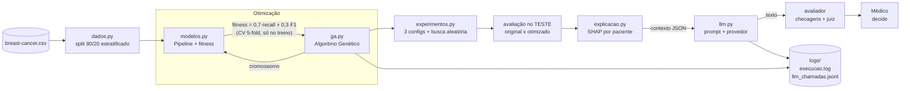
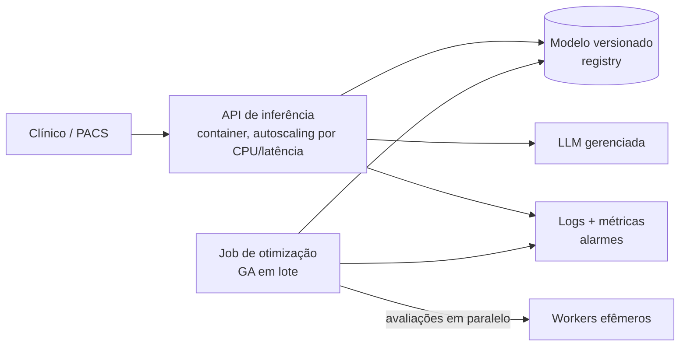

# Arquitetura e decisões de implementação

## Visão geral

## Módulos (`src/tc2/`)

| Módulo | Responsabilidade |
|---|---|
| `config.py` | Semente, caminhos, limiar clínico, pesos do fitness, configuração de logging |
| `dados.py` | Carga e split idêntico ao da Fase 1 (80/20, estratificado, `SEED=42`) |
| `ga.py` | `Gene`, `ConfigGA`, `AlgoritmoGenetico` (torneio, cruzamento uniforme/aritmético, mutação, elitismo, cache) e `busca_aleatoria` |
| `modelos.py` | Baseline da Fase 1, espaços de busca (genes) por modelo, `construir_pipeline` e `criar_fitness` |
| `experimentos.py` | As 3 configurações de GA, busca aleatória, avaliação no teste, tabelas comparativas |
| `explicacao.py` | Converte um modelo + uma paciente num **contexto estruturado** (probabilidade, faixa, fatores via SHAP: exato para árvores, por permutação para os demais) |
| `llm.py` | Prompts, provedores (`OllamaLLM` local/grátis, `ClaudeLLM`, `LLMOffline`), registro de chamadas, avaliação de qualidade |

## Decisões e por quê

| Decisão | Por quê |
|---|---|
| **GA implementado do zero** (sem DEAP/PyGAD) | O desafio pede explicitamente codificação, seleção, cruzamento e mutação; implementar mostra cada operador e mantém ~150 linhas testáveis |
| **Indivíduo = `dict` de hiperparâmetros**, com `Gene` tipado (`int`, `log`, `cat`) | Operadores genéricos para qualquer modelo; `C` da regressão logística em escala log, porque varia em ordens de grandeza |
| **Fitness só vê o treino** (CV 5-fold) | O teste fica intocado para medir o ganho real; usar o teste no fitness seria vazamento |
| **Fitness = 0,7·recall + 0,3·F1** | Mantém o fio condutor da Fase 1: o falso negativo é o erro caro (recall domina), e o F1 impede a solução alarmista "tudo é maligno" |
| **Semente fixa em todo o GA**, cache de fitness por cromossomo | Reprodutibilidade e economia: indivíduos repetidos (elitismo, clones) não são reavaliados |
| **Busca aleatória com o mesmo orçamento** como controle | Sem ela, não dá para afirmar que a *evolução* ajudou, e não apenas o fato de testar muitas combinações |
| **A LLM não calcula nem decide** | A probabilidade e as contribuições vêm do modelo de ML; a LLM só traduz o contexto JSON em linguagem clínica. Isso limita o dano de uma alucinação e permite checá-la automaticamente |
| **Dados em tags `<dados>`/`<notas_clinicas>`, separados das instruções** | Defesa contra *prompt injection* quando, no Módulo 3, houver texto livre de prontuários |
| **`temperature=0`** | Respostas reprodutíveis e auditáveis |
| **Ollama local como padrão** | LLM pré-treinada gratuita, sem chave e sem enviar dados de pacientes para fora; mesma interface do `ClaudeLLM`, então trocar de provedor não muda o resto |
| **Provedor offline (templates)** | O pipeline e os testes rodam sem chave de API. Não é uma LLM: a qualidade só é medida com o `ClaudeLLM` |

## Monitoramento e logging

- `logs/execucao.log` — uma linha por geração do GA (melhor, média, avaliações acumuladas).
- `logs/llm_chamadas.jsonl` — uma linha JSON por chamada à LLM: provedor/modelo, prompt usado, latência, tokens de entrada e saída, sucesso/erro. É a base para custo e alertas.
- `outputs/experimentos_ga.json` — histórico completo de cada experimento (curvas de convergência, tempo, nº de avaliações).

## Escalabilidade

Implementado localmente: cache de fitness (evita recomputar), `n_jobs=-1` na Random Forest, configurações de GA
parametrizáveis pelo orçamento de tempo (população × gerações), e *retry* com *backoff* exponencial nas chamadas à LLM.

**Proposta de nuvem (opcional no desafio; não implementada):**

- **Inferência**: containers atrás de um balanceador, escalando por latência; a demanda do hospital é sazonal (picos de manhã).
- **Otimização**: a avaliação de cada indivíduo é independente, então o GA escala quase linearmente com workers efêmeros (fila + *spot*).
- **LLM**: limite de taxa e fila com *retry*, mais cache de explicações por (paciente, versão do modelo).
